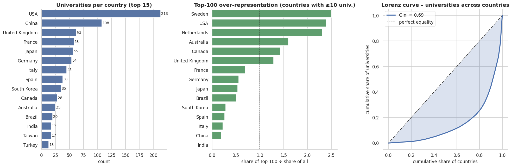
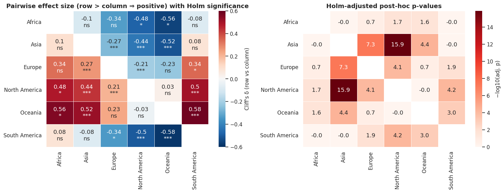
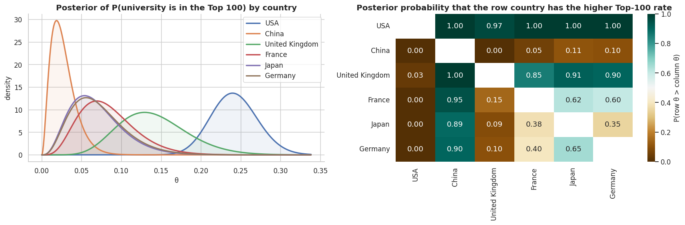
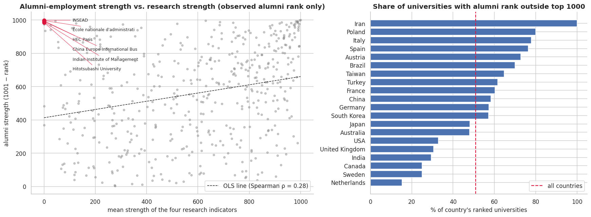

# 🎓 Universities Ranking Analysis | What Makes a World-Class University?
### A statistical analysis of the CWUR 2018–19 World University Ranking

[](PASTE_KAGGLE_NOTEBOOK_LINK)


A data-analysis project on the top 1,000 universities in the world (61 countries). It goes beyond exploring the data: it audits and repairs hidden data-quality problems, tests hypotheses with proper effect sizes and multiple-testing correction, quantifies uncertainty with bootstrap, permutation and Bayesian methods, and uses regression, PCA and clustering as *explanatory* tools. **There is no predictive machine learning** – the goal is to understand the data, not to forecast it.

> **Data:** *Universities Information Dataset* – ([link](https://www.kaggle.com/datasets/mbsoroush/universities-information-dataset))

---

## Research questions
1. How are the ranking indicators distributed, and how are they related?
2. Is university quality concentrated geographically – and are the differences statistically *and* practically significant?
3. What is the probability (with uncertainty) that a university from a given country reaches the Top 100?
4. Which indicators carry the most information about the final score?
5. Do the indicators reduce to a few dimensions or natural groups?
6. Which universities stand out relative to their research profile?

## Key findings

| # | Finding |
|---|---|
| 1 | **The data hid its own missing values.** A plain `isnull()` reports 0 missing, but placeholders (`"-"`, `"> 1000"`) conceal **60% missing Education** and **73% missing Faculty** values, and **51% of Alumni Employment ranks are censored** ("outside the top 1000"). The missingness is *related to rank* (not random), so those indicators were excluded from the main analyses and censoring was handled explicitly. |
| 2 | **Quality is highly concentrated.** The top 5 countries hold 50% of the 1,000 universities (Gini = 0.69). The **USA has 21% of the universities but 51% of the Top 100** (over-representation index 2.4×); China has 11% of the universities but only 2% of the Top 100. |
| 3 | **Continents differ significantly** (Kruskal–Wallis H = 99.9, p ≈ 6·10⁻²⁰, ε² = 0.10 → medium effect). Holm-corrected post-hoc tests show North America scoring significantly higher than Asia, Europe, South America and Africa; the North America–Oceania difference is not significant. |
| 4 | **USA vs. the rest:** median score 76.2 vs. 73.3 (difference 2.9, 95% bootstrap CI [1.6, 4.0]). Mann–Whitney, permutation and bootstrap agree. The effect is **statistically clear but small** (Cliff's δ = 0.30): a random US university outscores a random foreign one **65%** of the time. |
| 5 | **Tier depends on continent** (χ² p ≈ 7·10⁻¹⁸, Cramér's V = 0.23). A Bayesian Beta–Binomial model puts the chance of a US university reaching the Top 100 at **24% (95% credible interval 19–30%)**, versus roughly 3% for China. |
| 6 | **Research indicators move together** (Spearman ρ with score: Quality Publications 0.96, Research Output 0.89, Influence 0.89, Citations 0.85), while **Alumni Employment is only weakly related (ρ = 0.44)** – it measures something different. Heavy collinearity (VIF up to 43) means individual regression coefficients should not be over-interpreted. |
| 7 | **The score is convex in the ranks.** A log-rank regression explains **R² = 0.95** of the score vs. 0.85 for a linear one; adding the two sparse indicators barely helps (0.94 → 0.95), which points to information lost in converting measurements to ranks rather than missing predictors. |
| 8 | **Structure:** one "overall strength" component (PC1) captures 70% of the variance; clustering recovers the official tiers well (ARI = 0.71) but shows a continuum rather than distinct types. |
| 9 | **Standouts:** research explains only R² = 0.07 of alumni-employment standing. Business and professional schools (**INSEAD, HEC Paris, ENA, IIM Ahmedabad, Stockholm School of Economics**) have far stronger employment standing than their research implies, while top research universities (**UC San Diego, UC San Francisco, Karolinska**) have alumni ranks outside the top 1000. |

## Selected figures

| | |
|---|---|
|  |  |
| *Country counts, Top-100 over-representation and Lorenz curve* | *Pairwise effect sizes between continents (Cliff's δ, Holm-adjusted)* |
|  |  |
| *Posterior probability of reaching the Top 100, by country* | *Alumni-employment standing vs. research strength* |

## Methods

| Area | Techniques |
|---|---|
| **Data quality** | Hidden-missing detection, right-censoring flags (not naïve imputation), missingness-mechanism test, integrity checks, correct file encoding |
| **EDA** | Distribution fitting (AIC/KS), Q–Q plots, Lorenz curve & Gini, ridgeline and letter-value plots, hexbin density, clustered correlation matrix, LOWESS, radar charts |
| **Inference** | Kruskal–Wallis + Holm post-hoc, Mann–Whitney, permutation and bootstrap tests, χ² with Monte-Carlo p-values, Cramér's V, Cliff's δ, power analysis, Beta–Binomial Bayesian estimation, Holm and Benjamini–Hochberg correction |
| **Explanatory modelling** | OLS with robust (HC3) errors, functional-form comparison, VIF and diagnostics, PCA, K-Means (descriptive), residual analysis |

## Decisions worth noting
- **Censored, not missing:** `"> 1000"` is stored as a flag plus a boundary value, and a sensitivity analysis shows conclusions do not depend on that convention.
- **Non-parametric by design:** score distributions are skewed (normality tests and Q–Q plots reject normality), so rank-based tests are primary and parametric tests are only robustness checks.
- **Effect sizes next to every p-value:** with n = 1,000 almost everything is "significant"; the notebook reports what is *large enough to matter*.
- **Circularity acknowledged:** the score is built from the indicators, so correlations and regressions describe the ranking formula, not causes of excellence.

## Limitations
- Single snapshot (2018–19): no claims about change over time.
- Indicators are **ranks** (censored at 1,000), not raw measurements.
- Only the top 1,000 institutions are published, so results do not generalise to all universities.
- No GDP, population or R&D data, so geographic differences are **associations, not causal effects**.
- Country/continent patterns do not describe individual institutions (ecological inference).

## Possible extensions
- Join GDP / R&D-spend data and test whether the geographic gap shrinks after adjustment.
- Use all CWUR editions (2012–2019) to study rank dynamics.
- Hierarchical Bayesian model with partial pooling across countries.
- Interactive dashboard (e.g. Streamlit) for exploring country profiles.

## Reproduce
```bash
git clone PASTE_GITHUB_REPO_URL
cd REPO_NAME
pip install -r requirements.txt
# download eighteen_nineteen_university_datasets.csv from the Kaggle dataset into ./data/
jupyter lab universities_ranking_analysis.ipynb
```
On Kaggle: attach the dataset and click **Save & Run All** – the file path is detected automatically. Runtime is about two minutes on CPU.

## Project structure
```
├── universities_ranking_analysis.ipynb   # the full analysis (executed)
├── figures/                              # exported charts
├── data/                                 # place the CSV here (not committed)
├── requirements.txt
└── README.md
```
